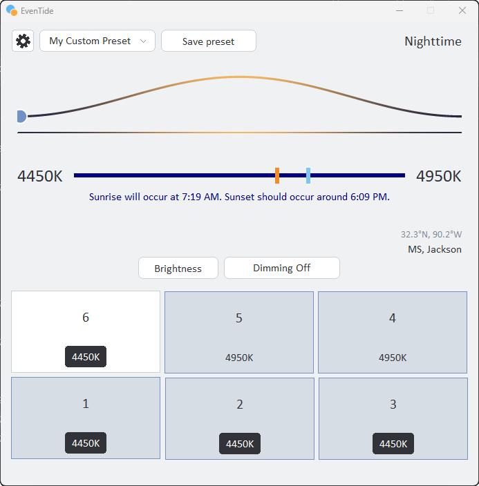

# EvenTide

EvenTide is a Windows application that dims the monitors you choose and shifts their color from daylight to nighttime. Each display can take a dimming lens, a color ramp, or both. The schedule follows the sun at a city you pick, or a clock you set.



## What it does

Dimming and color are separate.

- **Dimming** is a black lens over the displays you select. Brightness sets how opaque that lens is, from full brightness down to 20%. The lens is what actually darkens the screen.
- **Color** is a gamma ramp. A slider sets a nighttime temperature and a daytime temperature, from 1200K to 6500K in 50K steps. The ramp moves between those two as the sun moves. A gamma ramp changes the white point; it does not dim a black pixel, which is why color and dimming are independent.

The header reads **Daylight**, **Dusk**, **Nighttime**, or **Dawn** from the sun's altitude. Dusk and dawn cover the six degrees of civil twilight. Under the day curve, a sentence gives the next sunrise and sunset in local time. Those times are this program's horizon crossings, so they can sit a few minutes away from a published almanac.

Closing the window hides it. The tray icon, the lenses, and the current color stay in place. **Exit** on the tray menu is what ends the program: it removes the lenses, restores an identity gamma ramp, and writes settings.

A second launch does not start another copy. It shows the window that is already running.

## Using the window

The gear opens the **Time** dialog. Three choices control automatic dimming:

- **Transition at sunset** fades the lenses in across civil twilight. Uncheck it to snap dimming on at a clock time. The clock starts at 8:00 PM.
- **Revert at sunrise** fades the lenses out across dawn. Uncheck it to snap dimming off at a clock time. The clock starts at 7:00 AM.
- **Dim with schedule** lets those edges run. Uncheck it and dimming changes only when you click a monitor tile or the **Dimming** button.

**Brightness** opens nine steps, from `100% (full brightness)` through `20% (minimum brightness)`. The first run uses 70%. Forcing **Dimming On** applies that step immediately. While the schedule is in charge, daylight leaves the lenses off, twilight fades them, and night holds the step you picked.

The preset list holds saved profiles first, then seven built-in color names: Day and Candle, Easy on the Eyes, Warm All Night, Desk After Dark, Light Touch, Hearth, and True Color. **Save preset** stores the current temperatures, brightness, and per-monitor switches under a name. A profile does not store the city or the dimming schedule. **Default** on the tray menu restores the first-run temperatures and turns dimming and color on for every display. It leaves the city and the schedule alone.

The monitor tiles follow the Windows display arrangement and use the same numbers as Settings. Click a tile to include or exclude that display from dimming. Click the temperature on the tile to turn color on or off for that display. Color on follows the schedule. Color off uses the other half of the day: the day temperature at night, and the night temperature while the sun is up. With one display the tile reads `Display` and its number. With seven or more, a corner mark is the color control and the rest of the tile is the dim control. Up to 100 displays are shown.

The coordinates and the city name open a list of one city in each state, plus Washington, DC. The list is compiled into the program. There is no network lookup. The city nearest the first-run location is Jackson, MS.

The tray tooltip is **EvenTide**. Left-click shows the window. Right-click opens **Dimming On** or **Dimming Off**, **Brightness**, **Presets**, **About**, and **Exit**.

`EvenTide.exe --layout` prints each monitor's Settings number, GDI device name, and rectangle. It does not open a window, apply a lens, or change the gamma ramp.

## Requirements

- Windows 10 or later
- [Rust](https://rustup.rs/) stable for `x86_64-pc-windows-msvc`

The MSVC toolchain needs the Visual C++ build tools and a Windows SDK. `rustup` offers to install them. The only crate dependency is [`windows`](https://crates.io/crates/windows) 0.61, which Cargo downloads on the first build.

## Compile

From this directory:

```powershell
cargo test
cargo build --release
```

`cargo test` checks the schedule, preset, and layout math. It does not open a window, change a gamma ramp, or write the registry.

The release binary is `target\release\EvenTide.exe`. For day-to-day use from this tree, copy it to `C:\EvenTide\bin\EvenTide.exe` (the layout this repo uses). For an install meant for other accounts on the machine, put `EvenTide.exe` under `C:\Program Files\EvenTide\` — for example `C:\Program Files\EvenTide\EvenTide.exe`. Settings do not live next to the executable, so a Program Files install does not need a writable program folder.

A debug build is `cargo build`. Its binary is `target\debug\EvenTide.exe`.

The build script embeds the application icon from the premultiplied frames in `assets`. Those frames, and the CIE color-matching table `assets\cie-cmf-5nm.bin`, are compiled into the executable. The script also writes `assets\appicon.ico` and links it so Explorer shows the icon on `EvenTide.exe`.

## Settings

Preferences are stored per user under Local AppData (and the registry), so the binary can live in `C:\Program Files\EvenTide\` (or anywhere else) without writing beside the exe.

| Location | What it holds |
|---|---|
| `HKCU\Software\EvenTide` | Brightness, temperatures, city, coordinates, and the dimming schedule |
| `%LOCALAPPDATA%\EvenTide\presets.json` | Saved preset names and their monitor switches |
| `%LOCALAPPDATA%\EvenTide\monitors.json` | Which displays currently have dimming and color |

`%LOCALAPPDATA%\EvenTide` is usually `C:\Users\<user>\AppData\Local\EvenTide` (not Roaming — `%APPDATA%` already means Roaming). Monitor layouts are machine-specific, so Local AppData is the right place. On first run EvenTide creates that folder and seeds both JSON files if they are missing (`presets` starts empty; monitors start with dimming and color on every display). A normal exit writes the registry and both JSON files. **Save** in the Time dialog writes the registry immediately. If a JSON file is unreadable, EvenTide keeps the built-in presets and leaves both effects on every display, and it does not overwrite the broken file on exit.

On a machine with no saved settings, the first run uses 70% brightness, 6500K by day, 3400K at night, dimming and color on every display, and Jackson, MS. Both dimming edges follow the sun.

## Add to Startup

```powershell
Set-ItemProperty -Path 'HKCU:\Software\Microsoft\Windows\CurrentVersion\Run' -Name 'EvenTide' -Value '"C:\Program Files\EvenTide\bin\EvenTide.exe"'
```

## License

EvenTide is released under the [MIT License](LICENSE). Copyright 2026 clintljohnson.
